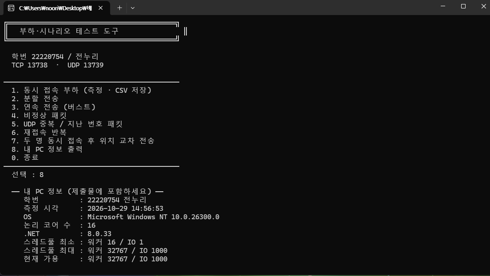
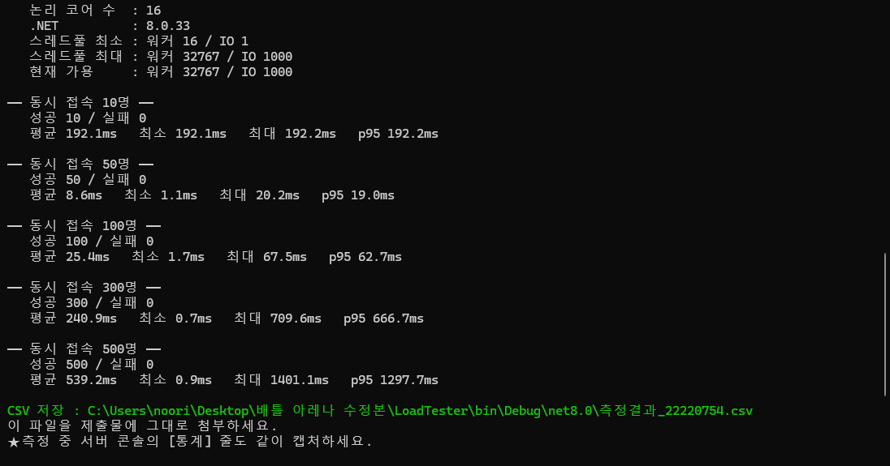

# 외주 서버 인수 검토 보고서 — 배틀아레나 v0.9

| 항목 | 내용 |
|---|---|
| 학번 / 이름 | 22220754 / 전누리 |
| 포트 | TCP 13738 · UDP 13739 |
| 측정 PC | Windows NT 10.0.26300 · 논리 코어 16개 · .NET 8.0.33 (`증거/B0_내PC정보.png`) |
| 결론 | **인수 반려** — 서버가 종료되는 결함과 동시 접속을 처리하지 못하는 결함이 있음 |

> ✏️ 표시가 있는 곳은 제출 전에 직접 채우거나 확인할 부분이다.

---

## 0. 요약

업체 검토서는 "치명적 결함 0건, 인수 가능"이라고 결론지었다. 그러나 LoadTester 시나리오를 실제로 실행해 보니 그렇지 않았다. 형식이 깨진 패킷(4번)이나 두 조각으로 나뉘어 도착한 패킷(2번) 하나만으로도 서버 프로세스가 종료되었다. 또 동시 접속자가 늘어나면 대부분의 접속자가 로그인하지 못했다. 이 밖에 UDP 위치 동기화에서도 좌표 오염, 중복 패킷 재적용, 위치 조작이 확인되었다. 따라서 납품본은 그대로 인수할 수 없다. 아래에 제시한 수정을 적용하면 모든 시나리오가 기대한 결과를 내며, 동시 접속 500명도 모두 처리된다.

---

## Part A — 고칠 곳

줄 번호는 모두 **납품 원본 기준**이다. 증거 캡처는 `증거/` 폴더에 있으며, 모든 캡처에 본인 포트(13738/13739)가 보인다.

### A-1. 접속자가 많아지면 로그인이 되지 않는다 (스레드 고갈)

- **재현 방법**
  1. 원본 OutsourcedServer를 실행한다.
  2. LoadTester를 실행해 1번을 고르고 그냥 엔터를 누른다.
  3. CSV의 성공/실패 수와 서버 [통계] 줄의 스레드 수를 확인한다.
- **증거**: `증거/A1_원본_부하측정.png`, `측정결과_22220754_수정전.csv` ✏️
- **원인**: `OutsourcedServer/PacketHelper.cs` 51행과 63행. `await Task.Run(() => socket.Receive(...))`는 비동기처럼 보이지만, 실제로는 블로킹 함수 `Receive`가 다음 패킷이 올 때까지 스레드풀의 워커 스레드를 붙잡고 있다. 접속자 한 명이 스레드 하나를 계속 점유한다. 그래서 접속자가 워커 수를 넘으면 나머지 접속자의 로그인 처리가 대기열에서 기다리게 된다.
- **고친 코드**

```csharp
// before (PacketHelper.cs 51, 63행)
int n = await Task.Run(() => socket.Receive(header, 0, 4, SocketFlags.None));
...
await Task.Run(() => socket.Receive(body, 0, bodyLength, SocketFlags.None));

// after
if (!await ReadExactAsync(socket, header, 4)) return null;
...
if (!await ReadExactAsync(socket, body, bodyLength)) return null;

private static async Task<bool> ReadExactAsync(Socket socket, byte[] buffer, int size)
{
    int read = 0;
    while (read < size)
    {
        int n = await socket.ReceiveAsync(
            new ArraySegment<byte>(buffer, read, size - read), SocketFlags.None);
        if (n == 0) return false;
        read += n;
    }
    return true;
}
```

### A-2. 로그인 직후 첫 패킷이 WELCOME이 아니다

- **재현 방법**: A-1만 고친 상태에서 LoadTester 1번을 실행하면, 접속자가 많은 구간에서 일부가 계속 실패한다. ✏️ (본인 PC에서 실패가 나오는지 확인)
- **증거**: `증거/A2_입장알림_먼저도착.png` ✏️
- **원인**: `OutsourcedServer/GameServer.cs` 125~132행의 `Broadcast`는 아직 로그인(WELCOME)을 마치지 않은 세션에게도 입장 알림(Type 20)을 보낸다. 그래서 일부 봇은 자신의 WELCOME(Type 11)보다 다른 봇의 입장 알림을 먼저 받는다. LoadTester는 첫 패킷이 WELCOME이 아니면 실패로 센다.
- **고친 코드**

```csharp
// ClientSession.cs — 속성 추가, WELCOME 전송 직후 true
public bool IsLoggedIn { get; private set; }
...
await SendAsync(new WelcomePacket { ... });
IsLoggedIn = true;

// GameServer.cs Broadcast
foreach (var pair in _sessions)
{
    if (pair.Key == exceptPlayerId) continue;
    if (!pair.Value.IsLoggedIn) continue;   // 추가
    _ = pair.Value.SendAsync(packet);
}
```

### A-3. 패킷이 두 조각으로 오면 서버가 종료된다

- **재현 방법**: 원본 서버 실행 → LoadTester 2번
- **증거**: `증거/A3_분할전송_서버종료.png` (서버 콘솔의 `Unhandled exception ... JsonReaderException ... ClientSession.HandlePacket`) ✏️
- **원인**: `PacketHelper.cs` 63행은 `Receive`가 요청한 길이를 모두 받았는지 확인하지 않는다. 그래서 앞 조각만 받은 잘린 JSON이 그대로 처리된다. 이때 발생한 예외는 `async void`(A-4) 때문에 잡히지 않고, 결국 프로세스 전체가 종료된다.
- **고친 코드**: A-1의 `ReadExactAsync`가 요청한 길이를 다 받을 때까지 반복해서 읽으므로 함께 해결된다. 예외 처리는 A-4에서 다룬다.

### A-4. Type이 없는 JSON 하나에 서버가 종료된다

- **재현 방법**: 원본 서버 실행 → LoadTester 4번
- **증거**: `증거/A4_비정상패킷_서버종료.png` (`RuntimeBinderException: Cannot convert null to 'int'`) ✏️
- **원인**: `OutsourcedServer/ClientSession.cs` 68행의 `private async void HandlePacket`과 73행의 `(int)packet.Type`. Type이 없으면 null을 int로 바꾸다 예외가 난다. 그런데 `async void` 메서드의 예외는 호출한 쪽에서 잡을 수 없어서 프로세스 전체가 종료된다.
- **고친 코드**

```csharp
// before (ClientSession.cs 50, 68, 73행)
HandlePacket(json);
private async void HandlePacket(string json)
{
    dynamic? packet = JsonConvert.DeserializeObject(json);
    if (packet == null) return;
    int type = (int)packet.Type;

// after
await HandlePacketAsync(json);
private async Task HandlePacketAsync(string json)
{
    int type;
    try
    {
        JObject? packet = JsonConvert.DeserializeObject<JObject>(json);
        int? t = packet?.Value<int?>("Type");
        if (t == null) { Console.WriteLine($"[경고] ID:{PlayerId} Type 없는 패킷 무시"); return; }
        type = t.Value;
    }
    catch (JsonException ex)
    {
        Console.WriteLine($"[경고] ID:{PlayerId} 깨진 JSON 무시 : {ex.Message}");
        return;
    }
```

### A-5. UDP 좌표가 이전 패킷의 남은 데이터로 오염된다

- **재현 방법**: 원본 서버 실행 → LoadTester 6번(재접속 반복)
- **증거**: `증거/A5_재접속_좌표오염.png` — 보낸 y값은 1~10인데 STATE에 110, 210 같은 값이 섞인다 ✏️
- **원인**: `OutsourcedServer/UdpServer.cs` 80행의 `Encoding.UTF8.GetString(buffer)`는 이번에 받은 길이가 아니라 1024바이트 버퍼 전체를 문자열로 바꾼다. 그래서 이번 패킷이 이전 패킷보다 짧으면 이전 패킷의 끝부분이 뒤에 붙어 좌표가 바뀐다.
- **고친 코드**

```csharp
// before
string msg = Encoding.UTF8.GetString(buffer);
// after
string msg = Encoding.UTF8.GetString(buffer, 0, result.ReceivedBytes);
```

### A-6. 같은 번호의 중복 패킷이 다시 적용된다

- **재현 방법**: 원본 서버 실행 → LoadTester 5번
- **증거**: `증거/A6_UDP중복.png` — 기대값은 적용 20 / 버림 15인데 원본은 적용 21 / 버림 14 ✏️
- **원인**: `UdpServer.cs` 129행 `if (seq < session.LastSeq)`. 같은 번호는 걸러지지 않아 중복된 seq 20(좌표 99, 99)이 적용된다. 그래서 마지막 위치가 (20, 5)가 아니라 (99, 99)가 된다.
- **고친 코드**

```csharp
// before
if (seq < session.LastSeq)
// after
if (seq <= session.LastSeq)
```

### A-7. 다른 사람의 플레이어 번호로 그 사람의 위치를 바꿀 수 있다

- **재현 방법**: 원본 서버 실행 → LoadTester 7번 → 서버 [통계] 줄 확인
- **증거**: `증거/A7_위치조작.png` — 원본은 적용 3 / 버림 0, 수정 후는 적용 2 / 버림 1 ✏️
  - LoadTester 화면에는 먼저 쌓여 있던 STATE가 표시되므로, 원본에서도 "(5,5)에서 안 바뀌었습니다"로 보일 수 있다. 그래서 판단 근거는 서버 [통계] 줄로 삼았다.
- **원인**: `UdpServer.cs` 120~124행은 처음 받은 주소를 기억만 하고, 이후 패킷이 그 주소에서 왔는지 확인하지 않는다.
- **고친 코드**

```csharp
if (session.UdpEndPoint == null)
{
    session.UdpEndPoint = from;
}
else if (!session.UdpEndPoint.Equals(from))   // 추가
{
    Interlocked.Increment(ref _droppedCount);
    return;
}
```

이 수정에도 한계는 남는다. 다른 사람이 첫 패킷을 먼저 보내면 주소를 가로챌 수 있다. 완전히 해결하려면 WELCOME에 토큰을 실어 보내고, 클라이언트가 MOVE 패킷에 그 토큰을 함께 보내게 해야 한다.

### A-8. TestClient가 위치 정보(STATE)를 전혀 받지 못한다

- **재현 방법**: 원본 서버와 원본 TestClient를 실행해 로그인한다.
- **증거**: `증거/A8_TestClient_수신중단.png` — 화면에 `[UDP 문제] 수신 중단 : InvalidOperationException You must call the Bind method...`가 뜬다 ✏️
- **원인**: `TestClient/Program.cs` 153~161행은 UDP 소켓을 만든 뒤 Bind 없이 바로 수신 루프를 시작한다. .NET은 Bind되지 않은 소켓으로 수신하려 하면 예외를 던지기 때문에, 수신 루프가 곧바로 종료된다.
- **고친 코드**

```csharp
_udp = new Socket(AddressFamily.InterNetwork, SocketType.Dgram, ProtocolType.Udp);
_udp.Bind(new IPEndPoint(IPAddress.Any, 0));   // 추가
```

### (선택) A-9. 닉네임으로 STATE에 가짜 플레이어를 끼워 넣을 수 있다

✏️ 과제가 의도한 결함인지 확실하지 않다. 틀리면 -3점이므로 확신이 없으면 이 항목은 지운다.

- **재현 방법**: TestClient 닉네임을 `Evil|999,Ghost,3,3`으로 입력해 접속한다.
- **원인**: `ClientSession.cs` 96행은 닉네임을 거르지 않고 그대로 STATE 문자열에 넣는다. 그래서 STATE가 `STATE|1,Evil|999,Ghost,3,3,10,5`가 되고, 다른 클라이언트에는 ID 999 "Ghost"가 나타난다.
- **고친 코드**: 닉네임에서 `|`와 `,`를 지우고 16자로 자른다.

### 고치지 않은 곳 (문제처럼 보이지만 정상)

- `Listen(512)`, `NoDelay = true`, `_stateBuilder` 필드, `MAX_BODY = 8192`, `_ = session.RunAsync()`, `Task.Delay(33)`, 브로드캐스트의 `catch { }`: 근거는 Part C에 정리했다.
- `UdpServer.cs`의 `IOControl(-1744830452)`: Windows에서 클라이언트가 사라졌을 때 수신 루프가 10054 오류로 깨지는 것을 막는 올바른 코드다.

---

## Part B — 몇 명까지 버티나

### 측정 환경

LoadTester 8번(내 PC 정보) 출력, 2026-10-29 14:56:53 측정



| 항목 | 값 |
|---|---|
| 학번 / 포트 | 22220754 전누리 / TCP 13738 · UDP 13739 |
| OS | Microsoft Windows NT 10.0.26300.0 |
| 논리 코어 수 | **16** |
| .NET | 8.0.33 |
| 스레드풀 최소 | 워커 16 / IO 1 |
| 스레드풀 최대 | 워커 32767 / IO 1000 |
| 현재 가용 | 워커 32767 / IO 1000 |

스레드풀 최소 워커 수가 코어 수와 같은 **16**이다. 스레드풀은 워커가 16개를 넘어서 더 필요해지면 즉시 만들지 않고 천천히 늘린다. 따라서 이 PC에서는 "동시에 블로킹으로 묶이는 스레드가 16개를 넘는 지점"이 성능이 꺾이는 기준선이 된다.

측정 도구: LoadTester 1번, 단계별 동시 접속 10 / 50 / 100 / 300 / 500명

### 측정 결과

**수정 전 (원본)** — `측정결과_22220754_수정전.csv`, `증거/B1_원본_부하측정.png` ✏️ (원본으로 측정한 뒤 채운다)

| 동시 접속 | 성공 | 실패 | 평균 ms | p95 ms | 최대 ms |
|---|---|---|---|---|---|
| 10 | ✏️ | ✏️ | ✏️ | ✏️ | ✏️ |
| 50 | ✏️ | ✏️ | ✏️ | ✏️ | ✏️ |
| 100 | ✏️ | ✏️ | ✏️ | ✏️ | ✏️ |
| 300 | ✏️ | ✏️ | ✏️ | ✏️ | ✏️ |
| 500 | ✏️ | ✏️ | ✏️ | ✏️ | ✏️ |

**수정 후** — `측정결과_22220754_수정후.csv` (2026-10-29 14:59 측정, `증거/B2_수정후_부하측정.png`)



| 동시 접속 | 성공 | 실패 | 평균 ms | p95 ms | 최대 ms |
|---|---|---|---|---|---|
| 10 | 10 | 0 | 192.1 | 192.2 | 192.2 |
| 50 | 50 | 0 | 8.6 | 19.0 | 20.2 |
| 100 | 100 | 0 | 25.4 | 62.7 | 67.5 |
| 300 | 300 | 0 | 240.9 | 666.7 | 709.6 |
| 500 | 500 | 0 | 539.2 | 1297.7 | 1401.1 |

### 어느 구간부터 나빠지는가

✏️ 원본 CSV를 보고 쓴다. 예시 문장: "원본은 동시 접속 ○○명까지는 실패가 0이었으나, ○○명 구간에서 실패가 ○○건으로 늘고 p95가 ○○ms로 뛰었다."

### 왜 거기서 나빠지는가

- **내 PC의 코어 수**: 16개다. LoadTester 8번 출력에서 스레드풀 최소 워커도 16으로 나왔다. 즉 이 PC의 스레드풀은 워커 16개까지는 바로 내주고, 그 이상은 천천히 늘린다.
- **접속자 한 명이 서버 자원을 쓰는 방식**: 원본 `PacketHelper.ReceiveAsync`(51·63행)는 `Task.Run` 안에서 블로킹 함수 `socket.Receive`를 부른다. 이 함수는 다음 패킷이 올 때까지 워커 스레드 하나를 붙잡고 기다린다. 로그인만 하고 가만히 있는 접속자도 스레드 하나를 계속 차지한다.
- **어느 숫자를 넘으면 갑자기 느려지는 이유**: 접속자 수가 워커 수(약 16)를 넘으면 새 접속자의 로그인 처리 작업이 대기열에서 기다린다. 스레드풀은 스레드를 한 번에 많이 만들지 않고 조금씩 늘린다. 그 사이 로그인이 밀리고, 먼저 로그인한 사람의 입장 알림이 대기 중인 접속자에게 먼저 도착해 실패가 늘어난다(A-2). 그래서 코어 수를 넘는 구간부터 결과가 급격히 나빠진다. ✏️ (본인 CSV의 구간과 서버 [통계] 줄의 스레드 수를 인용한다)
- **고치면 빨라지는 이유**: `socket.ReceiveAsync`는 기다리는 동안 스레드를 점유하지 않는다. 데이터가 도착했을 때만 잠깐 스레드를 빌려 쓴다. 그래서 접속자 수와 필요한 스레드 수가 더 이상 비례하지 않는다. 수정 후 측정에서는 10명부터 500명까지 모든 단계에서 실패가 0건이었다. 500명일 때도 p95가 1297.7ms로 10초 타임아웃에 한참 못 미쳤다.
- **수정 후에도 접속자가 늘면 느려지는 이유**: 수정 후에도 평균 응답이 100명 25.4ms → 300명 240.9ms → 500명 539.2ms로 늘었다. 하지만 이것은 스레드 고갈 때문이 아니다. 수백 개의 접속과 로그인이 한꺼번에 몰리면서 생기는 처리 대기 때문이다. 실패로 이어지지는 않았다.
- **10명 구간이 50명보다 느린 이유**: 10명 구간의 평균은 192.1ms로 50명(8.6ms)보다 오히려 크다. 첫 단계에서 서버와 LoadTester가 JSON 라이브러리 로드와 JIT 컴파일 같은 초기 준비를 하는 시간이 포함되었기 때문이다. 이후 단계에는 이 비용이 없다.

---

## Part C — 업체 검토서 판정

판정표는 별도 파일 `22220754_전누리_PartC_판정표.md`(및 `VendorReview_판정완료.docx`)에 정리했다. 요약하면 다음과 같다.

| 의견 | 판정 |
|---|---|
| 1. TCP/UDP 분리 | 동의 |
| 2. STATE 묶어 보내기 | 동의 |
| 3. await 누락 | 반대 |
| 4. 빈 catch | 반대 |
| 5. Task.Delay(33) | 반대 |
| 6. MAX_BODY 확대 | 반대 |
| 7. Listen(512)→100 | 반대 |
| 8. NoDelay 끄기 | 반대 |
| 9. StringBuilder 필드 | 반대 |
| 10. 부하 테스트 불필요 | 반대 |

실행 증명 2건(의견 10, 의견 3)도 판정표 파일에 있다.

---

## Part D — 작업 과정

### 1. git 커밋

저장소 주소와 `git log --oneline --graph` 출력은 `git.txt`에 있다. 캡처는 `증거/D1_git_log.png`이다. ✏️

### 2. 막혔던 일

✏️ 아래는 이번 작업에서 실제로 있었던 일을 바탕으로 쓴 초안이다. 본인이 겪은 순서와 다르면 고쳐 쓴다.

**막힌 일 1 — 실행하자마자 창이 꺼졌다**

- 처음 생각: 서버 코드에 문제가 있어서 실행이 안 되는 줄 알았다.
- 확인 방법: 여러 프로젝트 동시 시작으로 서버와 LoadTester를 함께 켜고, 꺼지기 전 화면을 확인했다. 두 창 모두 "학번을 먼저 입력하세요"가 떠 있었다.
- 결과: `Shared/StudentConfig.cs`의 `STUDENT_ID`가 0이면 `StudentConfig.Verify()`가 `Environment.Exit(1)`로 프로그램을 종료한다. 서버 코드 문제가 아니었다.
- 다음 생각: 학번과 이름을 넣고 다시 빌드하자 TCP 13738 · UDP 13739로 정상 실행되었다.

**막힌 일 2 — 고치지 않은 LoadTester가 "바뀐 파일"로 나왔다**

- 처음 생각: 서버와 TestClient만 수정했으므로 LoadTester는 원본 그대로라고 생각했다.
- 확인 방법: 원본 압축 파일의 `LoadTester/Program.cs`와 내 폴더의 파일을 diff로 비교했다.
- 결과: 내용은 같지만 정렬용 공백이 여러 줄 달라져 있었다. Visual Studio가 파일을 열 때 자동 서식을 적용한 것이었다. 공지문에 "LoadTester를 고친 흔적이 보이면 Part B 0점"이라고 되어 있어서, 그대로 두면 측정값을 의심받을 수 있었다.
- 다음 생각: LoadTester는 원본 파일로 다시 덮어썼다. 이후 제출할 파일은 공백 차이까지 diff로 확인한다.

**(대체용) 막힌 일 3 — 수신만 고쳤는데 일부 접속자가 계속 실패했다** ✏️ (본인 PC에서 재현되면 사용)

- 처음 생각: 스레드 고갈만 해결하면 모든 접속자가 성공할 것이라고 생각했다.
- 확인 방법: `PacketHelper`만 수정하고 LoadTester 1번을 다시 돌렸다. 대부분 성공했지만, 접속자가 많은 단계에서 몇 명이 계속 실패했다. 실패한 봇이 첫 패킷으로 받은 Type을 확인했다.
- 결과: 실패한 봇은 WELCOME(11)이 아니라 입장 알림(20)을 먼저 받았다. 원인이 하나가 아니었다.
- 다음 생각: `Broadcast`가 로그인 전 세션에도 보내는 것이 원인이라고 보고, `IsLoggedIn`을 추가해 해결했다(A-2).

---

## 제출 파일 구성

```
22220754_전누리_중간과제.zip
├─ 22220754_전누리_보고서.md
├─ 22220754_전누리_PartC_판정표.md
├─ VendorReview_판정완료.docx
├─ 측정결과_22220754_수정전.csv
├─ 측정결과_22220754_수정후.csv
├─ git.txt
├─ 증거/        (콘솔 캡처, 로그)
└─ 소스/        (고친 코드)
```
